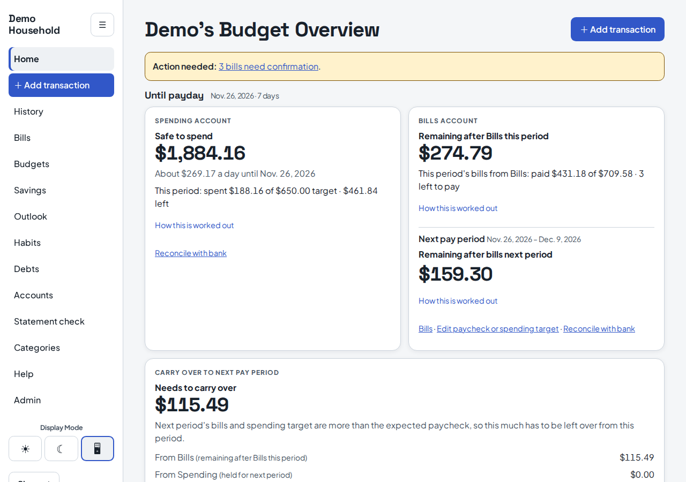
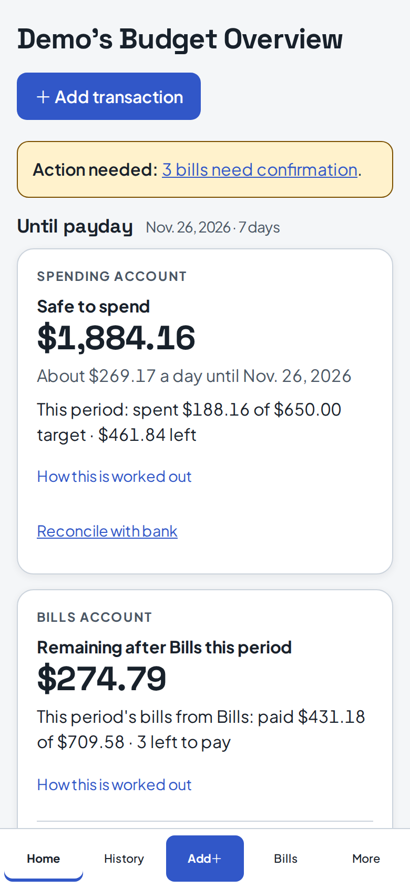
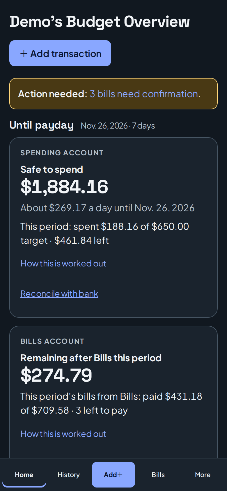
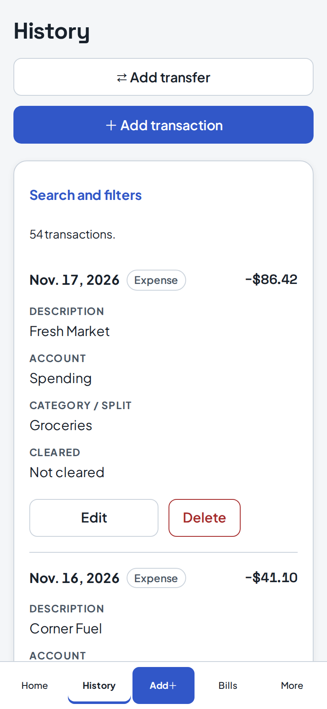
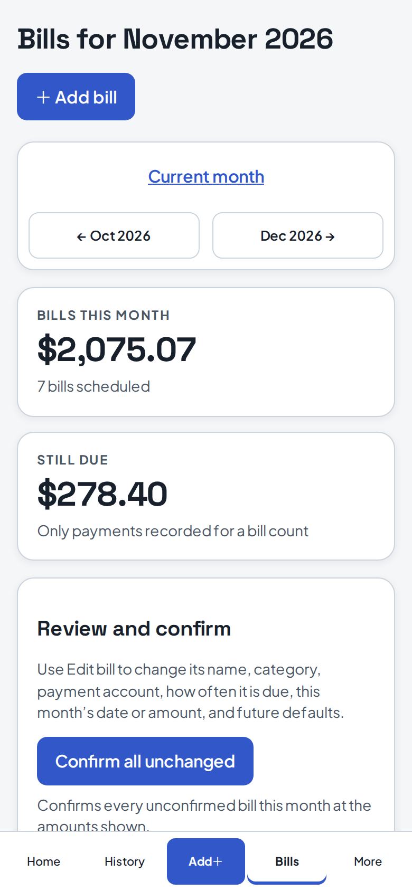
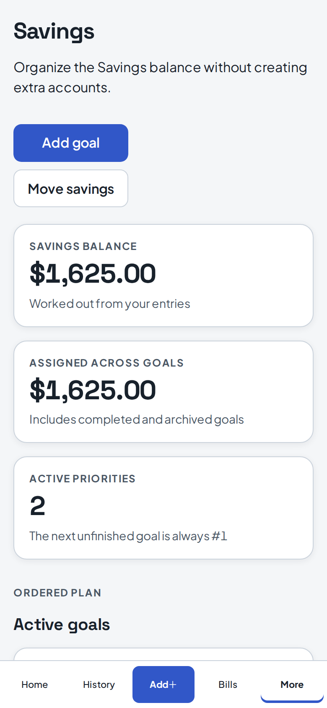
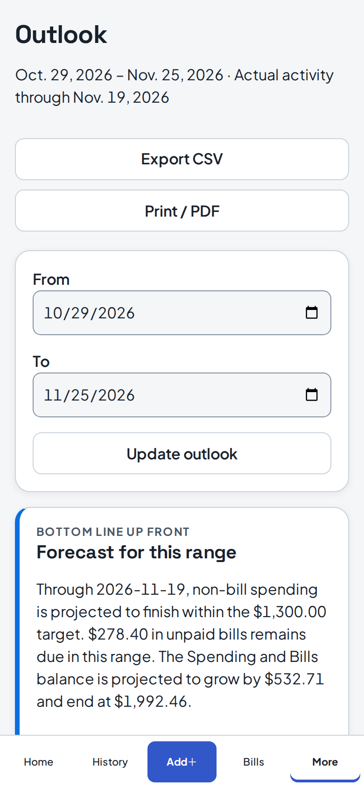
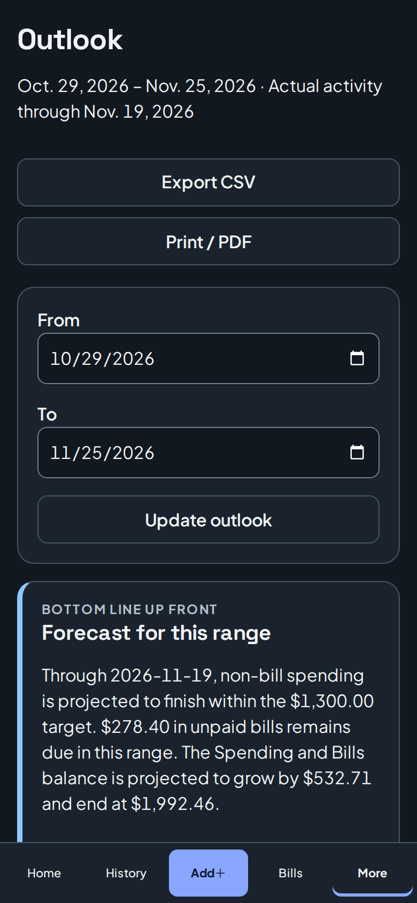
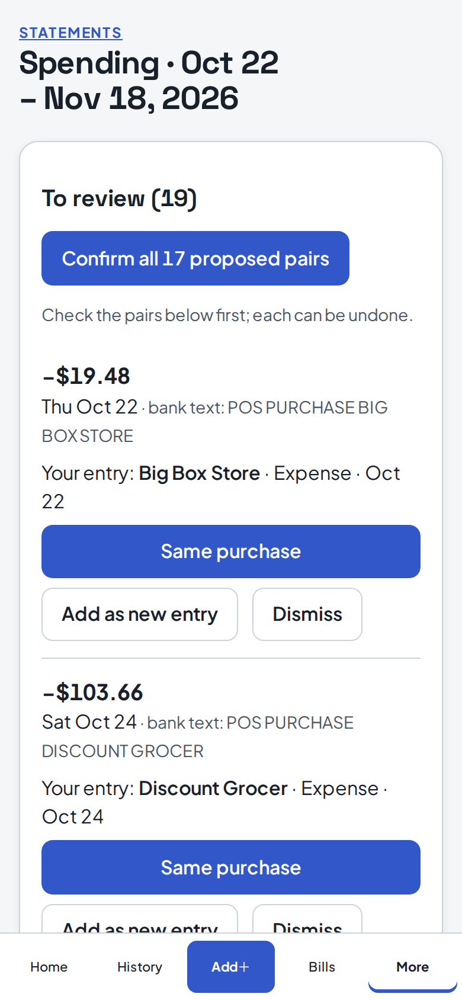

# NoNonCents

Simple control of your finances. A self-hosted personal and household budgeting application with spending analysis, financial forecasting, subscription tracking, bank statement reconciliation, and optional AI-powered insights. No bank connections. No unnecessary complexity.

NoNonCents runs on your own computer or server. Your budget data stays in your PostgreSQL database, and nothing is sent anywhere unless you turn on the optional AI analysis and point it at a model server.

## Features

- **Home**: what is safe to spend until the next payday, what the Bills account still has to cover, and how much needs to carry over.
- **Spending and Bills kept apart**: spending by category against targets, and bills by due date with confirm, paid, skip and edit steps.
- **Fast entry**: add an expense, income, refund or transfer in a few taps, with split expenses and "same as last time" shortcuts.
- **Pay periods**: pay dates, pay periods, locking finished periods, and reopening them only as an administrator.
- **Outlook**: a forecast for any date range, with charts, category tables, CSV export and Print / PDF.
- **Savings goals**: a savings balance organised into ordered goals, without extra bank accounts.
- **Debts and habits**: balances and payoff estimates from the statement figures you enter, and spending habits to review.
- **Bank statement check**: read the supported statement layout from a monthly PDF, match its rows to your entries, and reconcile balances. The PDF itself is not kept.
- **Several budget profiles** on one installation, each with its own accounts, bills, categories and users.
- **Backups**: verified nightly PostgreSQL dumps, copies to other folders, a restore drill, and an Admin page that shows backup health.
- **Light and dark themes**, a phone-first layout, keyboard-accessible pages, and in-app Help with search.
- **Optional AI insights**, off by default. See [AI analysis](#ai-analysis).

## Screenshots

These images come from the made-up **Demo Household** profile (`make demo`). They show no real data.

<table>
  <tr>
    <td align="center"><br>Home on a computer</td>
    <td align="center"><br>Home on a phone</td>
    <td align="center"><br>Home in dark mode</td>
  </tr>
  <tr>
    <td align="center"><br>History</td>
    <td align="center"><br>Bills</td>
    <td align="center"><br>Savings goals</td>
  </tr>
  <tr>
    <td align="center"><br>Outlook</td>
    <td align="center"><br>Outlook in dark mode</td>
    <td align="center"><br>Statement check</td>
  </tr>
</table>

## Quick start

You need [Docker](https://docs.docker.com/get-docker/) with Docker Compose v2: Docker Engine on Linux, or Docker Desktop on macOS and Windows. Git is optional.

1. Get the code:

   ```bash
   git clone <repository-url> nononcents
   cd nononcents
   ```

2. Start it:

   - **Linux or macOS**: `./start.sh`
   - **Windows**: double-click `start.cmd`, or run `.\start.ps1` in PowerShell.

   The script checks that Docker is running, creates `.env` with random secrets (an existing `.env` is never changed), builds and starts the app and its database, waits for the health check, offers to create the first administrator, and prints the address to open. It is safe to run again.

3. Open the printed address (by default <http://127.0.0.1:8000>) and sign in as the administrator.

To stop NoNonCents, run `docker compose down`. Never add `-v`: that deletes the database.

## First run

A new installation has no budget profile and no sample data.

1. Sign in with the administrator account you created. The app has no profile chooser yet, so it sends you to the setup page, **Welcome to NoNonCents**.
2. Name the first budget profile (for example "Household Budget") and select **Create profile**. The profile starts with Spending, Bills and Savings accounts and a few categories.
3. Use **Admin** to create more profiles and logins, and to give people access to the profiles they should see. Everyone else signs in and chooses a profile.
4. Set your time zone in `.env` (`TIME_ZONE`) before you record real dates. The default is `UTC`.

To try the app with sample data first, load the made-up demo profile:

```bash
docker compose exec web python manage.py seed_demo_profile --yes
```

It adds a separate "Demo Household" profile. Do not run it on an installation that must stay free of sample data.

The guide inside the app (**Help**) explains the rest, and [docs/guide/getting-started.md](docs/guide/getting-started.md) walks through setting up a profile step by step.

## Configuration

Settings live in `.env`, which the start script creates from [`.env.example`](.env.example). Change them there, then run `make up` (or `docker compose up -d`) to apply them. The most important ones:

| Setting | Default | What it does |
| --- | --- | --- |
| `DJANGO_SECRET_KEY` | created by the start script | Signing key. At least 50 random characters. Keep it secret and unique. |
| `POSTGRES_PASSWORD` | created by the start script | Password for the database user. |
| `TIME_ZONE` | `UTC` | Time zone for dates and pay periods, for example `Europe/London` or `America/Chicago`. Set it. |
| `WEB_BIND` | `127.0.0.1:8000` | Address and port the app is published on. The default is this computer only. |
| `ALLOWED_HOSTS` | `127.0.0.1,localhost` | Host names the app answers to. Add your own name. |
| `CSRF_TRUSTED_ORIGINS` | empty | Full `https://` addresses you browse from through a proxy. |
| `BACKUP_DIR` | `./backups` | Folder for database backups. |
| `BACKUP_COPY_DIRS` | empty | Extra existing folders that receive a verified copy of each backup. |
| `REPORT_LLM_PROVIDER` | `disabled` | Set to `openai_compatible` to enable the AI analysis. |

The full list, with the HTTPS and backup settings, is in [docs/deployment.md](docs/deployment.md#settings) and in `.env.example`.

## HTTPS

NoNonCents serves plain HTTP and does not handle certificates itself. For anything beyond one computer, put a reverse proxy in front of it (Caddy, nginx or similar), serve the app over HTTPS, and then set the HTTPS options in `.env`. The deployment guide has a generic Caddy and nginx example: [docs/deployment.md#https-behind-a-reverse-proxy](docs/deployment.md#https-behind-a-reverse-proxy).

## Backups

Backups are PostgreSQL dumps, each one restored into a scratch database and checked before it counts as successful. Run `make backup` to take one now, and `make restore FILE=...` to restore one. Schedule the nightly backup with cron or a systemd timer, and rehearse a restore with `make restore-drill` at least now and then. See [docs/backup-and-restore.md](docs/backup-and-restore.md).

## AI analysis

The Outlook page can ask an AI model for a written summary. It is **off by default**, and nothing is sent anywhere until you enable it.

> **Warning:** when the analysis is enabled, a summary of your financial totals (aggregate amounts, category and account names, and pay dates) is sent to the endpoint in `REPORT_LLM_URL`. Use a model server you run yourself or one you trust, such as a local [Ollama](https://ollama.com/) or [llama.cpp](https://github.com/ggml-org/llama.cpp) server. Individual transactions, merchant names and notes are not sent.

Any OpenAI-compatible chat completions endpoint works. The details, including how to reach a model server from the Docker container, are in [docs/report-analysis.md](docs/report-analysis.md).

## Development

You need Python 3.12, GNU Make and, for the browser tests, Node.js 18 or newer.

```bash
make setup                  # creates .venv and installs the locked development tools
make migrate                # local development database (SQLite unless POSTGRES_DB is set)
.venv/bin/python manage.py createsuperuser
make dev                    # http://127.0.0.1:8000
make demo                   # optional: the made-up Demo Household profile, local database only
```

Before you hand over a change, run the quality gate:

```bash
make format lint typecheck test
```

Browser tests drive the app in Chromium (run them after installing the browser once):

```bash
npm ci
npx playwright install chromium
make browser-test
```

Playwright uses port 8775 by default; set `BROWSER_TEST_PORT` if that port is taken. `make browser-test-webkit` runs the phone-layout check in WebKit through Docker. `make guide-screenshots` regenerates the guide images from the demo profile.

The project layout, the money rules and the contribution process are in [CONTRIBUTING.md](CONTRIBUTING.md), [docs/architecture.md](docs/architecture.md) and [docs/calculation-rules.md](docs/calculation-rules.md). The contributor guide for coding agents is [AGENTS.md](AGENTS.md).

## Documentation

- [User guide](docs/user-guide.md): the in-app guide chapters.
- [Deployment](docs/deployment.md) and [Backup and restore](docs/backup-and-restore.md): running the app.
- [Calculation rules](docs/calculation-rules.md) and [Understanding the numbers](docs/guide/understanding-the-numbers.md): how every figure is worked out.
- [Product specification](docs/product-specification.md), [Architecture](docs/architecture.md), [Data model](docs/data-model.md) and [Decisions](docs/decisions.md).

## Security

Please report vulnerabilities privately; see [SECURITY.md](SECURITY.md). Do not open a public issue for a security problem.

## Licence

NoNonCents is released under the MIT Licence. See [LICENSE](LICENSE).
