<div align="center">

<h1><picture><source media="(prefers-color-scheme: dark)" srcset="docs/readme/wordmark-dark.png">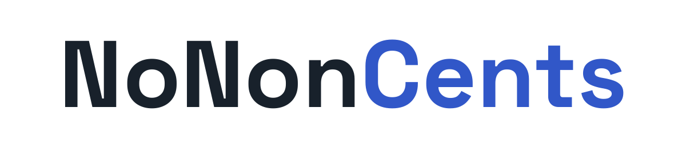</picture></h1>

<b>Simple control of your finances, on your own server.</b><br>
<b>No bank connections. No unnecessary complexity.</b><br><br>

<a href="LICENSE"></a>
<a href="#get-started"></a>


<br><br>

<a href="#what-it-does">What it does</a> · <a href="#get-started">Get started</a> · <a href="#your-data-stays-yours">Your data stays yours</a> · <a href="#learn-more">Learn more</a> · <a href="#about">About</a><br><br>

<code>git clone https://github.com/AM-Turing/nononcents.git && cd nononcents && ./start.sh</code><br><br>

<picture><source media="(prefers-color-scheme: dark)" srcset="docs/readme/hero-dark.png">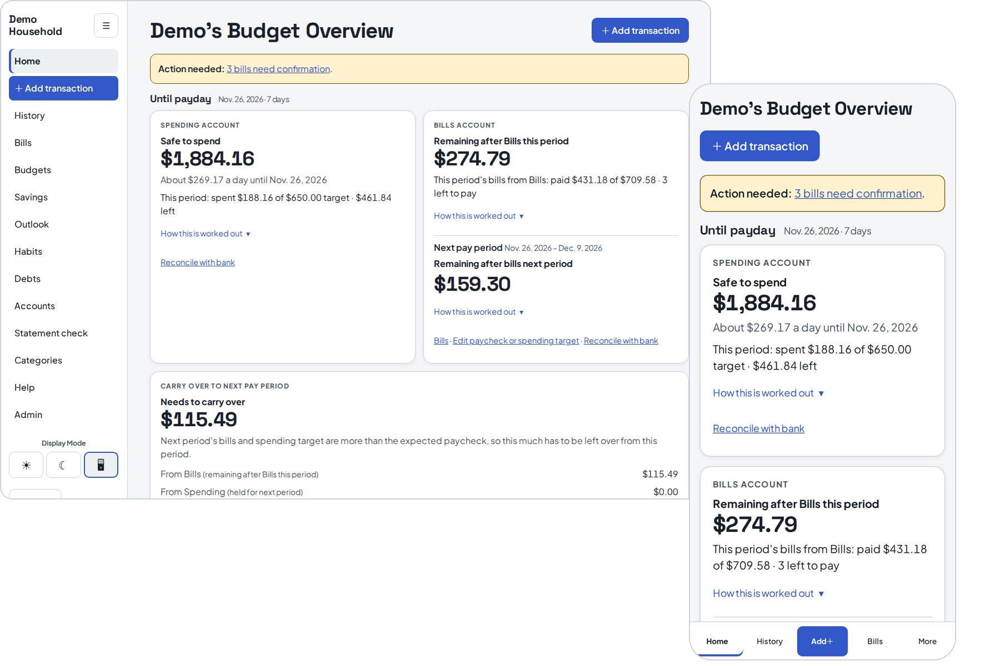</picture>

</div>
<br>

Simple control of your finances. A self-hosted personal and household budgeting application with spending analysis, financial forecasting, subscription tracking, bank statement reconciliation, and optional AI-powered insights. No bank connections. No unnecessary complexity.

Ask NoNonCents the questions you already ask at the kitchen table:

- *"How much can I safely spend until payday?"*
- *"Will my bills be covered before the next paycheck?"*
- *"How much needs to carry over into next period?"*
- *"Does this month's bank statement match what I entered?"*
- *"Which spending habits are worth a second look?"*
- *"When will this debt be paid off at this rate?"*

---

## What it does

These screenshots come from the made-up **Demo Household** profile. They contain no real data.

<table>
  <tr>
    <td align="center" width="33%"><a href="docs/guide/images/home.png">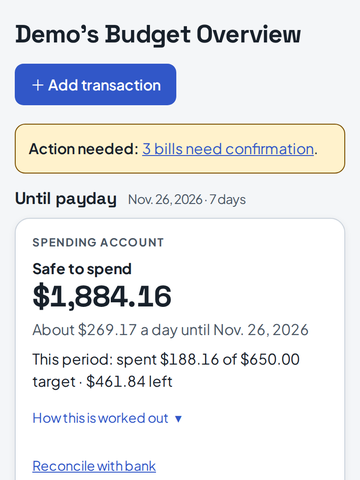</a><br><b>Home</b><br><sub>Safe to spend until payday</sub></td>
    <td align="center" width="33%"><a href="docs/guide/images/history.png">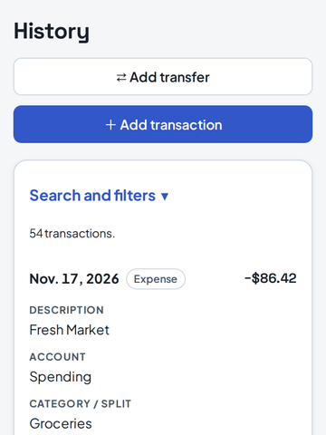</a><br><b>History</b><br><sub>Every entry, searchable and filterable</sub></td>
    <td align="center" width="33%"><a href="docs/guide/images/bills.png">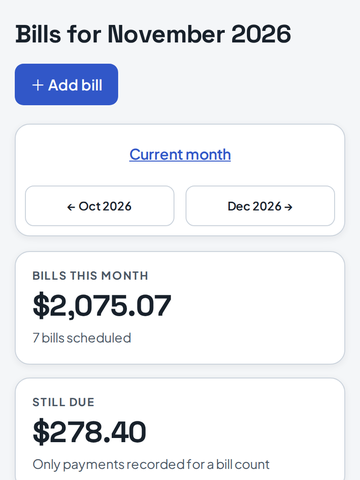</a><br><b>Bills</b><br><sub>Bills by due date, confirmed or paid</sub></td>
  </tr>
  <tr>
    <td align="center" width="33%"><a href="docs/guide/images/budgets.png">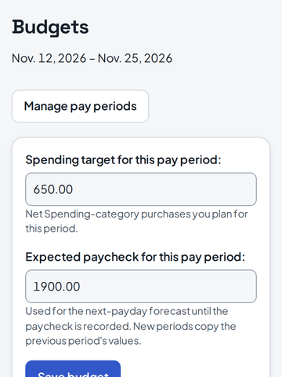</a><br><b>Budgets</b><br><sub>Spending targets and expected paycheck</sub></td>
    <td align="center" width="33%"><a href="docs/guide/images/savings.png">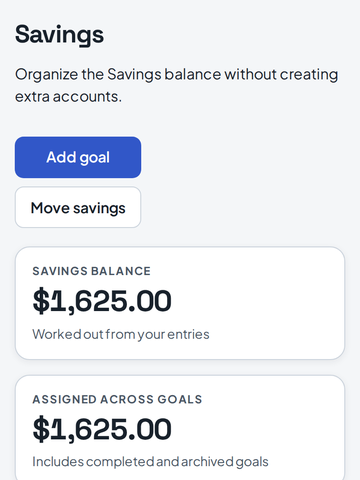</a><br><b>Savings</b><br><sub>Savings goals without extra accounts</sub></td>
    <td align="center" width="33%"><a href="docs/guide/images/outlook.png">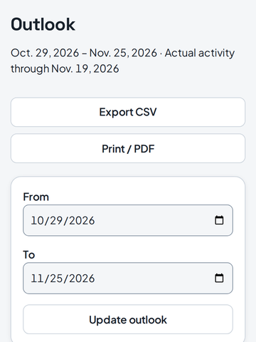</a><br><b>Outlook</b><br><sub>Forecasts, charts and CSV export</sub></td>
  </tr>
  <tr>
    <td align="center" width="33%"><a href="docs/guide/images/statement-review.png">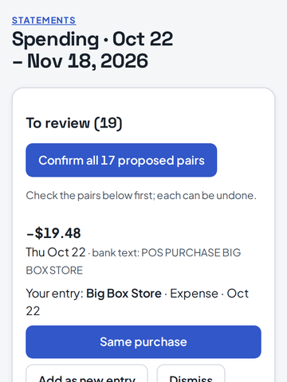</a><br><b>Statement check</b><br><sub>Match a bank statement to your entries</sub></td>
    <td align="center" width="33%"><a href="docs/guide/images/debts.png">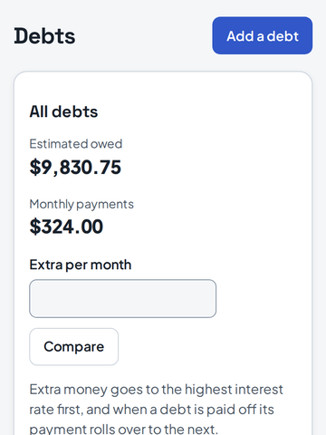</a><br><b>Debts</b><br><sub>Balances and payoff estimates</sub></td>
    <td align="center" width="33%"><a href="docs/images/home-dark.png">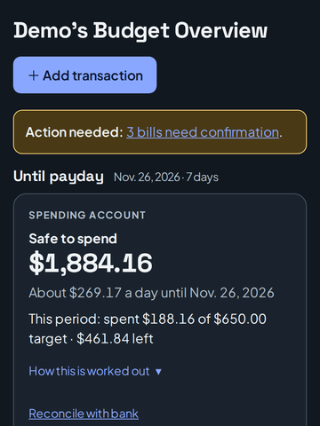</a><br><b>Dark mode</b><br><sub>Phone view in dark mode</sub></td>
  </tr>
</table>

Everything else in the box:

- **Home**: what is safe to spend until the next payday, what the Bills account still has to cover, and how much needs to carry over.
- **Spending and Bills kept apart**: spending by category against targets, and bills with confirm, paid, skip and edit steps.
- **Fast entry**: add an expense, income, refund or transfer in a few taps, with split expenses.
- **Pay periods**: pay dates and pay periods, with finished periods locked and reopened only by an administrator.
- **Outlook**: a forecast for any date range, with charts, category tables, CSV export and Print / PDF.
- **Savings goals**: a savings balance organised into ordered goals, without extra bank accounts.
- **Debts and habits**: balances and payoff estimates from the statement figures you enter, and spending habits to review.
- **Bank statement check**: reads PDF statements from most banks, checks them against the statement's balances, and matches the rows to your entries. The PDF itself is not kept.
- **Several budget profiles** on one installation, each with its own accounts, bills, categories and users.
- **Activity log**: sign-ins and changes in Admin, kept for 60 days by default.
- **Backups**: verified PostgreSQL dumps, copies to other folders, a restore drill, and an Admin page that shows backup health.
- **Light and dark themes**, a phone-first layout, keyboard-accessible pages, and in-app Help with search.
- **Optional AI insights**, off by default. See [Your data stays yours](#your-data-stays-yours).

---

## Get started

You need [Docker](https://docs.docker.com/get-docker/) with Docker Compose v2: Docker Engine on Linux, or Docker Desktop on macOS and Windows. Git is optional.

1. **Get the code.** Clone the repository, or download it as a ZIP file and unzip it into a folder called `nononcents`.

   ```bash
   git clone https://github.com/AM-Turing/nononcents.git
   cd nononcents
   ```

2. **Start it.** On Linux or macOS, run `./start.sh`. On Windows, double-click `start.cmd`, or run `.\start.ps1` in PowerShell. The script creates your settings file with random secrets, starts the app and its database, and waits until the app is ready. It is safe to run again.
3. **Create the administrator.** When the script offers, create the first administrator account. Then open the address it prints, by default <http://127.0.0.1:8000>, and sign in.
4. **Name your budget profile.** The **Welcome to NoNonCents** page asks for a name, such as "Household Budget". Before you record real dates, set `TIME_ZONE` in `.env` (default `UTC`), then run `docker compose up -d`.

To stop NoNonCents, run `docker compose down`. Never add `-v`, because that deletes the database.

Want to look around first? `docker compose exec web python manage.py seed_demo_profile --yes` adds a separate, made-up Demo Household profile.

---

## Your data stays yours

- **Self-hosted.** It runs on your own computer or server, and your budget data stays in your PostgreSQL database.
- **No bank connections.** You enter what happened, or check a bank's PDF statement against your entries. The PDF itself is not kept.
- **No telemetry.** There are no analytics and no third-party content. Pages load only the app's own scripts, styles and images.
- **AI is off by default.** Nothing is sent to an AI model until you turn it on.

> **Warning:** when AI analysis is enabled, a summary of your aggregate totals, category and account names, and pay dates is sent to the endpoint in `REPORT_LLM_URL`. Use a model server you run yourself or one you trust, such as a local [Ollama](https://ollama.com/) or [llama.cpp](https://github.com/ggml-org/llama.cpp) server. Individual transactions, merchant names and notes are not sent. The details are in [docs/report-analysis.md](docs/report-analysis.md).

---

## Learn more

Inside the app, **Help** holds the full guide, with search. The same guides are in the repository:

- [User guide](docs/user-guide.md) and [Getting started](docs/guide/getting-started.md) for everyday use.
- [Understanding the numbers](docs/guide/understanding-the-numbers.md) explains how every figure is worked out.
- [Administrator guide](docs/guide/administrator.md) and [Troubleshooting](docs/guide/troubleshooting.md) cover profiles, logins and fixing problems.
- For those running the app: [Deployment](docs/deployment.md), [Calculation rules](docs/calculation-rules.md) and [Architecture](docs/architecture.md).

<details>
<summary><b>Configuration</b></summary>

Settings live in `.env`, which the start script creates from [`.env.example`](.env.example). Change them, then run `make up` (or `docker compose up -d`). The main ones are `TIME_ZONE` (default `UTC`), `WEB_BIND` (default `127.0.0.1:8000`, this computer only), `ALLOWED_HOSTS`, `BACKUP_DIR` and `REPORT_LLM_PROVIDER` (default `disabled`).

Full list: [docs/deployment.md#settings](docs/deployment.md#settings).

</details>

<details>
<summary><b>HTTPS</b></summary>

NoNonCents serves plain HTTP and does not handle certificates itself. For use beyond one computer, put a reverse proxy such as Caddy or nginx in front, serve the app over HTTPS, then set the HTTPS options in `.env` (for example `TRUST_PROXY_HTTPS=true` and your `https://` address in `CSRF_TRUSTED_ORIGINS`).

Full guide, with Caddy and nginx examples: [docs/deployment.md#https-behind-a-reverse-proxy](docs/deployment.md#https-behind-a-reverse-proxy).

</details>

<details>
<summary><b>Backups</b></summary>

Backups are PostgreSQL dumps. Each one is restored into a scratch database and checked before it counts as successful. `make backup` takes one now, `make restore FILE=...` restores one, and `make restore-drill` rehearses a restore without touching live data. Schedule the nightly backup with cron or a systemd timer.

Full guide: [docs/backup-and-restore.md](docs/backup-and-restore.md).

</details>

<details>
<summary><b>Development</b></summary>

You need Python 3.12, GNU Make and, for the browser tests, Node.js 18 or newer. `make setup` creates `.venv`, `make dev` runs the local server at http://127.0.0.1:8000, and `make demo` loads the Demo Household locally. The quality gate is `make format lint typecheck test`. Browser tests run with `npm ci`, `npx playwright install chromium` and `make browser-test`.

Contributor details: [CONTRIBUTING.md](CONTRIBUTING.md) and [AGENTS.md](AGENTS.md).

</details>

---

## About

NoNonCents is made by **A.M. Turing** and released under the MIT Licence. See [LICENSE](LICENSE).

Issues, ideas and contributions are welcome. Read [CONTRIBUTING.md](CONTRIBUTING.md) before opening a pull request. To report a security problem, follow [SECURITY.md](SECURITY.md) and do not open a public issue.
