# Technical dependencies

NoNonCents is a server-rendered Django 5.2 LTS monolith with PostgreSQL, a Docker Compose
deployment, Playwright browser tests, and one optional feature (Deep Pattern Analysis on the
Outlook page) that calls any OpenAI-compatible model server, such as llama.cpp or Ollama. No
LLM SDK is used in Python; the adapter uses the standard-library `urllib` module.

## Dependency map

```mermaid
flowchart TB
    subgraph host["Host prerequisites (README)"]
        docker["Docker Engine + Compose"]
        make["GNU Make"]
        pyhost["Python 3.12+ (dev venv)"]
        nodejs["Node.js >=18 + npm (browser tests)"]
        ops["Host firewall, reverse proxy (HTTPS), model server reachable from the web container"]
    end

    subgraph compose["compose.yml — topology"]
        subgraph webimg["web — built from Dockerfile (FROM python:3.12.16-slim, 2-stage wheel build)"]
            gunicorn["gunicorn 23.0.0 — 3 workers, :8000"]
            django["Django 5.2.19 [argon2] — sessions, Argon2 hashing"]
            wn["whitenoise 6.12.0 — compressed, hashed static serving"]
            mdk["Markdown 3.9 — renders docs/ for Help (/docs/)"]
            psycopg["psycopg 3.2.13 [binary]"]
            urllib["stdlib urllib.request — LLM adapter (no SDK)"]
        end
        subgraph dbimg["db — image postgres:17.12-alpine"]
            pg["PostgreSQL 17.12"]
            pgdump["pg_dump / pg_restore — backup.sh / restore.sh"]
        end
        v1[("postgres_data volume")]
        n1["frontend network"]
        n2["database network — internal, no published port"]
    end

    subgraph pytree["Python runtime closure (verified in .venv)"]
        direction TB
        d["Django 5.2.19"] --> a1["asgiref 3.13.0"]
        d --> a2["sqlparse 0.6.1"]
        d --> a3["argon2-cffi 25.1.0"]
        a3 --> a4["argon2-cffi-bindings 26.2.0"]
        a4 --> a5["cffi 2.1.1"]
        a5 --> a6["pycparser 3.12"]
        p["psycopg 3.2.13"] --> p1["psycopg-binary 3.2.13"]
        p --> p2["typing_extensions 4.16.0"]
        py["pypdf 7.1.1 — statement PDF reading"]
        g["gunicorn 23.0.0"] --> g1["packaging 26.3"]
        md["Markdown 3.9 — in-app Help pages, no deps"]
        w["whitenoise 6.12.0 — no deps"]
    end

    subgraph devtree["Dev tools (requirements-dev.lock)"]
        direction TB
        mypy["mypy 1.17.1"] --> m1["mypy_extensions 1.2.0"]
        mypy --> m2["pathspec 1.1.1"]
        ds["django-stubs 5.2.2 [compatible-mypy]"] --> ds1["django-stubs-ext 6.1.2"]
        ds --> ds2["types-PyYAML 6.0.12.20261113"]
        pytest["pytest 8.4.1"] --> t1["iniconfig 2.3.1"]
        pytest --> t2["packaging 26.3"]
        pytest --> t3["pluggy 1.7.0"]
        pytest --> t4["Pygments 2.21.0"]
        pd["pytest-django 4.11.1"]
        ruff["ruff 0.12.7"]
        st["setuptools 80.9.0 (build-system)"]
    end

    subgraph nodetree["Node browser tests (package-lock.json, all dev)"]
        direction TB
        pwt["@playwright/test 1.55.1"] --> pw["playwright 1.55.1"]
        pw --> pwc["playwright-core 1.55.1"]
        pw -.->|"optional, darwin only"| fe["fsevents 2.3.2"]
        pwc --> chr["Chromium binary — npx playwright install chromium"]
        axp["@axe-core/playwright 4.10.2"] --> axc["axe-core 4.10.3"]
        axp -.->|"peer dep"| pwc
    end

    subgraph llm["Optional model server — runs outside compose"]
        llsrv["OpenAI-compatible server (llama.cpp, Ollama or similar) — POST /v1/chat/completions; bearer token only if REPORT_LLM_API_KEY is set"]
        textm["Text model — report narrative, schema-constrained JSON, temperature 0, max_tokens from REPORT_LLM_MAX_TOKENS (default 2200)"]
        llsrv --> textm
    end

    docker -->|"make up (docker compose up -d --build)"| compose
    make -->|"up / down"| docker
    make -->|"setup: venv + pip install"| pyhost
    pyhost --> devtree
    pyhost -->|"pip install -r requirements.lock"| pytree
    nodejs -->|"npm ci"| nodetree
    make -->|"browser-test"| nodetree

    gunicorn --> django
    django --> wn
    django --> psycopg
    django --> urllib
    psycopg -->|"internal network"| pg
    dbimg --> v1
    webimg --> n1
    dbimg --> n2
    pgdump --> pg

    urllib -->|"REPORT_LLM_* — aggregate totals JSON + REPORT_ANALYSIS_SCHEMA; optional bearer token"| llsrv
    ops -.->|"endpoint must be reachable from web container; never localhost when on compose host"| llsrv
```



## Python runtime

`requirements.in` lists the direct dependencies; `requirements.lock` is generated from it by
pip-compile and pins every package, including transitive ones, with SHA-256 hashes.
`requirements-dev.in` adds the development tools on top (`-c requirements.lock`), locked in
`requirements-dev.lock`. The Docker build and `make setup` install with `--require-hashes`.
`pyproject.toml` repeats the direct pins.

pip-compile is not installed in the virtual environment; run it through `uvx`, which comes with
[uv](https://docs.astral.sh/uv/). After editing `requirements.in` or `requirements-dev.in`:

```bash
uvx --python 3.12 --from pip-tools pip-compile --generate-hashes --allow-unsafe --strip-extras -o requirements.lock requirements.in
```

```bash
uvx --python 3.12 --from pip-tools pip-compile --generate-hashes --allow-unsafe --strip-extras -o requirements-dev.lock requirements-dev.in
```

```bash
.venv/bin/pip install --require-hashes -r requirements-dev.lock
```

Check with `git diff requirements.lock` that only the intended packages moved. Patch updates
within the pinned series only, unless an upgrade is planned. A new image picks the lock up with
the next `make up`.

| Direct | Version | Verified transitive closure |
|---|---|---|
| Django[argon2] | 5.2.19 | asgiref 3.13.0, sqlparse 0.6.1, argon2-cffi 25.1.0 → argon2-cffi-bindings 26.2.0 → cffi 2.1.1 → pycparser 3.12 |
| gunicorn | 23.0.0 | packaging 26.3 |
| psycopg[binary] | 3.2.13 | psycopg-binary 3.2.13, typing_extensions 4.16.0 |
| whitenoise | 6.12.0 | none |
| Markdown | 3.9 | none; renders the in-app Help pages from `docs/` (`budget/guide.py`), raw HTML disabled |
| pypdf | 7.1.1 | In `pyproject.toml` and `requirements.lock`; reads statement PDFs (`budget/statement_pdf.py`) |

## Python dev tools

Pinned in `requirements-dev.lock` (extends `requirements.lock`):

| Direct | Version | Verified transitive closure |
|---|---|---|
| django-stubs[compatible-mypy] | 5.2.2 | django-stubs-ext 6.1.2, types-PyYAML 6.0.12.20261113 |
| mypy | 1.17.1 | mypy_extensions 1.2.0, pathspec 1.1.1 |
| pytest | 8.4.1 | iniconfig 2.3.1, packaging 26.3, pluggy 1.7.0, Pygments 2.21.0 |
| pytest-django | 4.11.1 | — |
| ruff | 0.12.7 | — |
| setuptools (build-system) | 80.9.0 | — |

## Node browser tests

Pinned in `package-lock.json` (lockfileVersion 3); all packages are dev-only.
Requires Node.js >= 18 and the Chromium binary from
`npx playwright install chromium`. The WebKit audit (`make browser-test-webkit`) instead runs in
the Docker image `mcr.microsoft.com/playwright:v1.55.1-noble`, matching the pinned version.

| Direct | Version | Transitive closure |
|---|---|---|
| @playwright/test | 1.55.1 | playwright 1.55.1 → playwright-core 1.55.1; fsevents 2.3.2 (optional, darwin only) |
| @axe-core/playwright | 4.10.2 | axe-core 4.10.3; peer dependency on playwright-core |
| playwright-core | 1.55.1 | Chromium browser binary |

## Docker

| Item | Reference | Notes |
|---|---|---|
| web base image | `python:3.12.16-slim` | Two-stage build: `pip wheel` in builder, offline `pip install --no-index --find-links=/wheels` in runtime; unprivileged `app` user; `collectstatic` at build time |
| db image | `postgres:17.12-alpine` | No published port; health check via `pg_isready`; named volume `postgres_data` |
| volumes | `postgres_data` | Named volume for PostgreSQL state |
| networks | `frontend`, `database` | `frontend` is the default network for `web`; `database` is internal (no external access) |
| host tools | Docker Compose, GNU Make | `pg_dump`/`pg_restore` run inside the db container by `scripts/backup.sh` / `scripts/restore.sh` |

## Local LLM

The only non-containerized runtime dependency, and it is optional: with the provider
disabled, reports remain fully ledger-calculated.

- **Server**: any OpenAI-compatible `POST /v1/chat/completions` endpoint, such as llama.cpp
  or Ollama. The adapter sends a bearer token only when `REPORT_LLM_API_KEY` is set. The
  endpoint must stay on a network you trust and be reachable from the web container (never
  `localhost` when the model runs on the Compose host). `docs/deployment.md` (AI analysis)
  shows how to reach a model server from the container.
- **Report analysis** (`budget/report_analysis.py`, `OpenAICompatibleReportAnalyzer`, run from
  `budget/analysis_jobs.py`): text model receiving only aggregate ledger totals.
  `temperature=0`, `max_tokens` from `REPORT_LLM_MAX_TOKENS` (default 2200, bounded
  500–32000), optional `enable_thinking: false` through `REPORT_LLM_DISABLE_THINKING`,
  `json_schema` + `response_format` constraints. The
  request runs in a background thread; the model call is bounded by
  `REPORT_LLM_TIMEOUT_SECONDS` (default 120, bounded 5–300). Full settings are in
  `docs/report-analysis.md`.
- **Python cost**: zero. Stdlib `urllib.request` only; no LLM SDK dependency.

## Environment configuration

Deployment is environment-driven (see `.env.example` and the settings table in
[Deployment](deployment.md#settings)): secret key and debug, hosts and trusted origins,
`WEB_BIND`, the `POSTGRES_*` connection, the HTTPS flags (`TRUST_PROXY_HTTPS`,
`SECURE_SSL_REDIRECT`, secure cookies, `SECURE_HSTS_SECONDS`), `TRUSTED_PROXY_NETWORKS`, the
`BACKUP_*` folders and limits, and the `REPORT_LLM_*` block above. When `POSTGRES_DB` is unset,
`nononcents/settings.py` falls back to SQLite (`SQLITE_PATH`, default `db.sqlite3`); the
Playwright harness uses that with an isolated database (`BROWSER_TEST_SQLITE_PATH`, a file in the
system temporary folder by default) on port 8775 (`BROWSER_TEST_PORT`) under `BROWSER_TEST_MODE=true`.

## Notes

- The frontend is hand-rolled CSS and vanilla JS with self-hosted Plus Jakarta
  Sans and Space Grotesk variable fonts (`budget/static/fonts/`); no HTMX, Alpine,
  CDN or build step.
- There is no PDF library; reports use the browser's Print / PDF (the old `pdf` extra, weasyprint,
  was removed because nothing imported it).
