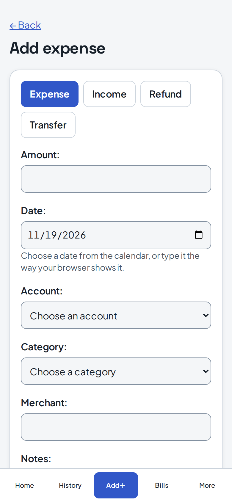
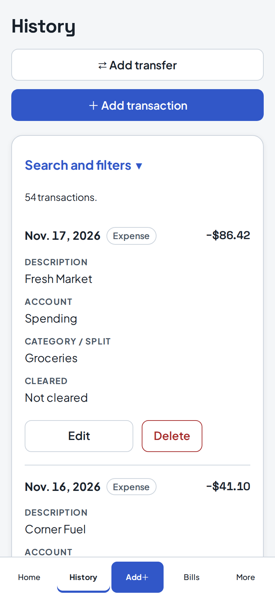
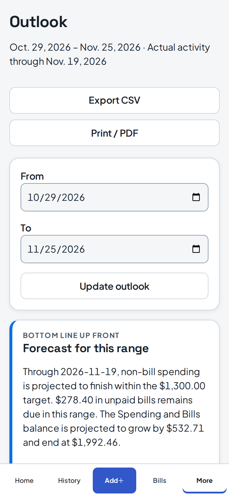

# Everyday use

Once your profile is set up (see [Getting started](getting-started.md)), the app needs only a
few minutes a day: record what you spend, tick off bills as you pay them, and check the
statement once a month.

Amounts can be typed the way you like: `1234.56`, `1,234.56` or `$1,234.56` all save the same
amount. Use a full stop for cents. `12,50` is refused on purpose, so it is never mistaken for
twelve hundred and fifty. Forms such as `1e3` and `1_000` are refused too.

## Add an expense

1. Select **＋ Add transaction** (on a phone: **Add⁠＋**). The form opens on **Add expense**.
2. Enter the **Amount**, for example `42.17`.
3. Enter the **Date**. It may start at the date of your last entry if that was in the last
   week, so check it each time.
4. Choose the **Account** the money came from.
5. Choose the **Category**, for example `Groceries`.
6. Enter the **Merchant**, for example `Corner Market`, and any **Notes**.
7. Select **Save**, or **Save and add another** to go straight to a blank form.

To record something else, select **Expense**, **Income**, **Refund** or **Transfer** at the top
of the form. Switch before you type, because the link opens a new, blank form.

The message at the top confirms the expense and shows the account's new balance, for example
`Expense of $42.17 saved to Spending. Resulting balance: $1,234.56.`

### Which account goes with which category

- A purchase from **Spending** (or **Savings**) uses a Spending category.
- A purchase from **Bills** uses a Bill category.
- A Utilities bill may also be paid from Spending.

If you choose a category that does not fit the account, the form says so and nothing is saved.

### Enter expenses faster

- **Merchant memory.** Start typing a merchant you have used before and pick it from the list.
  The account and category fill in from the last time. Change them if this purchase is
  different.
- **Remembered date and account.** A new expense or refund opens with the account and date of
  the last one you saved.
- **Save and add another.** Saves and opens a fresh form of the same type, handy after a
  shopping trip. It is there on income and transfer forms too.

### Split one purchase across categories

For a receipt with, say, groceries and household items on it:

1. On **Add expense**, enter the total **Amount**.
2. Open **More options** and tick **Split this transaction across categories**. The split
   fields open below the amount.
3. For each part, choose **What it was for** (the category) and enter the
   **Cost of this part**. Add at least two parts.
4. Watch the **Left to assign** line. It shows how much of the total still has no amount. When
   the parts match the total, it says **Everything is assigned.** If the parts add up to more
   than the total, it says **Over by** and the amount.
5. Save when the parts add up exactly to the total.

**Remove** on a part is greyed out when only two parts are left, because a split needs at
least two. To go back to one category, untick the split box.

Each category can be used once in a split. History shows every part with its amount.

### Mark a purchase essential or not

**Spending classification** is under **More options**. It normally follows the category.
Choose **Essential** or **Non-essential** to change it for this one purchase, for example a
dinner out that was really a work trip meal.

### When the date looks unusual

A date more than 60 days ago, more than 31 days ahead, or outside every pay period has to be
confirmed. Check the year, then tick **This date is correct** and save again. A date more than
a year away is refused.

### Choose the date

Pick the **Date** from the calendar, or type it the way your browser shows dates. When the date
is filled in from your last entry, the help under the field says so, for example
`Same date as your last entry (Nov 18, 2026).` Change it if this entry is from a different day.

### Saving twice by accident

If you tap **Save** twice, the entry is still saved only once and the app says
"That entry was already saved." If you are not sure an entry went through, look in **History**
before entering it again.

## Add income

1. Select **＋ Add transaction**, then **Income** at the top of the form (or **Add income** in
   **Quick actions** on Home).
2. Enter the **Date**, **Source** (for example `Employer payroll`), **Amount** and any notes.
3. For your normal pay, tick **This is the regular paycheck**. The pay period it funds then
   starts on this date. For one-off money, tick **This is irregular income** instead.
4. Split the amount between the accounts: fill in **Spending allocation**,
   **Bills allocation**, **Savings allocation** and so on. The parts must add up exactly to the
   amount. For example, a `2,000.00` paycheck could be `700.00` Spending, `1,100.00` Bills and
   `200.00` Savings.
5. If any goes to Savings, choose the **Savings destination goal**.
6. Select **Save**.

**Repeat last time's split.** When you type a source you have used before, the split fills in
from last time. The account that got the most last time takes whatever is left, so if the
paycheck is a little different, only that account changes. To use the suggested split exactly,
leave every allocation blank and save.

## Record a refund

A refund puts money back and lowers your spending. It is not counted as income.

1. Select **＋ Add transaction**, then **Refund** at the top of the form.
2. Enter the **Amount** and **Date**.
3. Choose the **Account** the money went back into and the **Category** of the original
   purchase.
4. Optionally choose the **Original expense (optional)**. The list shows the last 120 days.
5. Enter the merchant, then select **Save**.

A refund cannot be more than the original purchase, or be dated before it. A refund into
Savings needs a **Savings goal**.

## Add a transfer between accounts

Use this when you move money yourself, for example from Spending to Bills. It is neither
income nor spending.

1. Select **＋ Add transaction**, then **Transfer** at the top of the form. **⇄ Add transfer** on
   **History** and **Add transfer** in **Quick actions** open the same form.
2. Enter the **Amount** and **Date**.
3. Choose where the money comes from and where it goes. They must be different accounts.
4. If it goes into Savings, choose the **Savings destination goal**.
5. Select **Save**. The message says that income and spending totals were not changed.

## Use Quick actions

**Quick actions** on Home (below the account cards on a phone, beside **Upcoming bills** on a
computer) are shortcuts: **Add expense**, **Add income**, **Add transfer**, **Add refund** and
**Edit budgets**, plus any your administrator has added.

## Pay and manage bills

Open **Bills** to see one month at a time. Use the **← month** and **month →** buttons to move
between months. Open **What do the statuses mean?** for a reminder of **Unconfirmed**,
**Confirmed**, **Partially paid**, **Paid** and **Skipped**.

### Confirm this month's bills

At the start of a month, check each bill's amount and due date.

When bills are waiting, Home shows **Action needed: N bills need confirmation**. Select the
**N bills need confirmation** part to go straight to **Bills → Review and confirm**.

- Select **Confirm** on a bill that is right.
- Select **Confirm all unchanged** to confirm every unconfirmed bill at the amount shown. The
  message says how many bills were confirmed. If some were skipped because their pay period is
  locked, it also says how many.
- If an amount is different this month, open **More** on that bill's row, select **Edit bill**,
  change **Amount for this month** and save. Tick **Use this amount for future months too**
  only if it has changed for good.

### Mark a bill paid

When a bill has been paid in full, select **Paid $…** on its row. The button shows the amount
still owing. The payment is recorded as an expense dated today, from the bill's payment
account, and the bill shows **Paid**. If today is in a locked pay period, the payment is
refused. A payment dated in an open period can still pay a bill that falls due in a locked period.

A banner at the top then confirms the payment and offers two choices:

- **Undo** deletes the payment and puts the bill month back the way it was before you pressed
  **Paid**. Use it if you pressed the wrong bill.
- **Change date** opens the payment so you can choose the day it was really paid. The bill stays
  paid.

The banner says **Undo works within 10 minutes.** Only the latest **Paid** press can be
undone. After 10 minutes, or after another **Paid**
press, the banner is gone and you can correct the payment from **History**.

### Record a different bill payment

For a payment of a different amount, or on another date:

1. Select **＋ Add transaction**. The form opens on **Add expense**.
2. Enter the amount and date, the account that paid it, and a Bill category.
3. Open **More options**. Under **Apply payment to bill (optional)**, choose the bill.
4. Leave **Bill month (optional)** blank to let the app pick the nearest unpaid month, or choose
   the month yourself. A skipped month never takes a payment. If the app would pick one, it
   refuses the payment with "A skipped bill month cannot receive a payment." Choose an unpaid
   month instead.
5. Save.

A part payment shows the bill as **Partially paid**, with the amount still owing.

### Skip a month or stop a bill

- **Skip**: nothing is due this month. On the bill's row, select **Skip**, which sits next to
  **Confirm**. Enter a **Reason for skipping**, then **Skip this month**.
- **Remove**: the bill has ended. On the bill's row, open **More**, then select **Remove**. It is
  removed from the selected month onward; months already paid are kept. Unpaid months before
  the selected month stay on Bills, and you can still pay them.

### Older unpaid bills

A bill from before the current pay period that is still unpaid shows on Home as
"older unpaid bills need review". Open **Bills**, then mark it paid or skip it. These are not
counted in the Home figures until you deal with them.

## Find, fix or delete an entry in History

Open **History** to see your latest entries, 50 to a page. A new profile with no entries shows
**No transactions yet**, with a link to add your first expense.

### Search and filter

- Type in **Search transactions**: a merchant, note, category, account or an exact amount.
- Narrow it with **Account**, **Type** (Expense, Income, Refund, Transfer or Balance
  correction), **From** and **To**, then select **Search**.
- **Clear** removes every filter.
- With one account chosen, a **Balance after** column shows the balance after each entry.
- A line above the list gives the number of entries, for example `12 transactions match your
  filters.`
- On a phone, the filters sit under **Search and filters**. Open it to search. It opens by
  itself when a filter is set, and the summary then says **(active)**. On a computer the
  filters are always shown.

### Edit an entry

Select **Edit**, make the change and save. The type cannot be changed; delete the entry and add
it again as the right type. Changing an amount marks the entry not cleared again, because it no
longer matches the statement, and it sends its matched bank statement line back to
review (for a transfer, both lines). For an income split between accounts, only the account whose
amount you change is marked not cleared again. Changing just the date or the notes keeps the
match.

### Delete an entry and undo it

Select **Delete**. The entry is removed at once. The banner says **Undo works within 10 minutes, for the latest
delete only.** Select **Undo** there to bring it back. Entries that involve Savings, and balance corrections,
cannot be undone: for those, the app asks you to type a confirmation first.

Deleting an entry sends its matched bank statement line back to review, and Undo does not match
it again. If you delete an expense that had refunds, the refunds stay on record but are no
longer linked to it; Undo links them again. Undo works once. A second Undo restores nothing.

### What cleared means

**Cleared** means the bank has shown this entry. The **Cleared** column in **History** shows
Cleared, Partly cleared or Not cleared.

- **Statement check** ticks an entry for you when you confirm its match to a bank statement line.
- **Reconcile** lets you tick entries by hand. Open **Accounts**, select **Reconcile** beside the
  account, and tick each entry that is on the bank statement. Ticked entries are marked cleared
  when you select **Reconcile account**.

A cleared mark is only a tick. It never changes a balance.

Uncleared entries are the ones the bank has not shown yet. Look at them to spot mistakes: a
purchase entered twice, or with the wrong amount, will stay uncleared. They also explain most
differences between the app's balance and the bank's balance, and **Reconcile** lists them.

## Do the monthly statement check

Once a month, when your bank statement is ready:

1. Open **Statement check** from the menu (on a phone: **More → Statement check**). Select
   **Upload a statement PDF**, choose the PDF and select
   **Read statement**. The PDF must be the bank's own statement, not a scan or a photo. If the
   app refuses it, or says a statement is **not verified**, see
   [Troubleshooting](troubleshooting.md#a-statement-is-refused).
2. Work through **To review**: **Same purchase** for each correct pair, **Add as new entry**
   for anything you forgot, **Dismiss** for anything that is not yours to record.
3. Look at **Not on a statement yet**. Recent entries usually show next month; old ones may be
   duplicates or mistakes.
4. Reconcile each account: **Accounts → Reconcile**, enter the statement date and ending
   balance, **Compare**, then **Reconcile account**.

Uploading the same or an overlapping statement never adds a line twice. The full steps are in
[Import and check your first bank statement](getting-started.md#import-and-check-your-first-bank-statement).

## Move money between savings goals

1. Open **Savings** and select **Move savings**.
2. Enter the **Date** and **Amount**, then enter **Dollars from this goal** for each goal the
   money comes from.
3. Choose **Move to another goal**, or **Or move to another account** to take it out of Savings.
4. Select **Move savings**.

When a goal is reached and you spend the money, use **Spend fulfilled goal** on its card. A
purchase from Savings must be covered by the goal's money on that date. Moving the date of a
Savings deposit to a later day is refused if spending from that goal before the new date would
not be covered.

## Spot spending habits

**Habits** (on a phone: **More → Habits**) shows small purchases that add up, which merchants
you visit most, and how each category changes over time. It looks back over the last 6 pay
periods and counts purchases of $20.00 or less.

- Open **Adjust** to try other settings without saving them, then **Show**.
- Select **＋ Save as new view** to keep a set of settings as a chip at the top of the page.
- **Category budgets this pay period** shows each budgeted category's spent and remaining.
- In **Cleanup queue**, add missing merchant names, or pick one spelling for a merchant typed
  several ways and select **Use this name**.

## Keep debts up to date

When a lender statement arrives, open **Debts**, select **Enter balance** on that debt, enter
the **Balance as of** date and **Balance owed**, and save. To see how an extra payment would
help, type an amount in **Extra per month** under **All debts** and select **Compare**.
**Archive** stops tracking a debt you have paid off.

## Look ahead with Outlook

**Outlook** (on a phone: **More → Outlook**) shows where the selected dates are heading.
Choose **From** and **To**, then **Update outlook**. It shows actual income and spending so far,
a projection to the end of the range, a spending pie and a daily chart. See
[Read the Outlook page](understanding-the-numbers.md#read-the-outlook-page).

**Export CSV** downloads the figures as a spreadsheet file. A text cell that starts with `=`, `+`,
`-` or `@` is saved with a leading apostrophe (') so the spreadsheet shows it as text instead of
running it as a formula. Amounts stay numbers. **Print / PDF** opens the print
window, where you can save a PDF. **Generate AI analysis** writes a plain-language review. It
usually takes about a minute. The **Deep Pattern Analysis** card updates itself when the review
is ready. The rest of the page, and any open section, stays as it is. To update the card by
hand, select **Check again**.

## Lock a finished pay period

When a pay period is over and everything is checked, lock it so it cannot be changed by
accident.

1. Open **Budgets → Manage pay periods**.
2. Select **Lock** beside the finished period.

A locked period refuses new, changed or deleted entries, bills, budgets and reconciliations in
its dates. Only an administrator can **Reopen** it. A payment dated in an open period can still
pay a bill that falls due in a locked period. Each change is checked against its own date.

## A simple routine

**Every day (or after shopping)**

1. Add each purchase, with **Save and add another** for several.
2. Glance at **Safe to spend** on Home.

**Every week**

1. Mark bills paid as they leave the bank.
2. Look at **History** for anything missing or entered twice.

**Every payday**

1. Add the paycheck with **This is the regular paycheck** ticked and check the split.
2. On **Bills**, use **Confirm all unchanged** and fix any amounts that changed.
3. Check the spending target and expected paycheck on **Budgets**.
4. Move money between accounts if the plan needs it.

**Every month**

1. Do the [monthly statement check](#do-the-monthly-statement-check) and reconcile each account.
2. Enter new debt balances from lender statements.
3. Look at **Outlook** and **Habits**.
4. Lock the pay periods that are finished.
