# Getting started

This chapter takes you from your first sign-in to a budget that is ready for everyday use.
Follow the sections in order. Each one builds on the one before it. Plan on about an hour,
with your latest bank statement and your list of monthly bills beside you.

Before you begin, your administrator creates your **budget profile** (your household's own
budget) and a username for each person who will use it. If you do not have a username yet,
ask your administrator.

## Open the app and sign in

1. On your phone or computer, open the web browser and go to the address your administrator gave you (it starts with `https://`).
2. Under **Profile**, choose your budget profile.
3. Enter your **Username** and **Password**.
4. Select **Sign in**.

The first time you open the app on a new phone or computer, the browser may warn that the
connection is not private. That means the device does not yet trust the home network's
security certificate. Do not continue past the warning. Follow
[The browser says the connection is not private](troubleshooting.md#the-browser-says-the-connection-is-not-private)
first; it only has to be done once per device.

> **Tip:** Save the address as a bookmark, or on an iPhone use **Share → Add to Home Screen**,
> so the app opens like any other app.

## Find your way around

**On a computer**, the menu is down the left side: **Home**, **＋ Add transaction**,
**History**, **Bills**, **Budgets**, **Savings**, **Outlook**, **Habits**, **Debts**,
**Accounts**, **Statement check**, **Categories** and **Help** (this guide). Administrators also see **Admin**. The **☰** button at the
top collapses the menu, and the browser remembers your choice. **Display Mode** and
**Sign out** are at the bottom.

**On a phone**, the bar along the bottom has **Home**, **History**, **Add⁠＋**, **Bills** and
**More**. **More** opens the rest: **Budgets**, **Savings**, **Outlook**, **Habits**,
**Debts**, **Accounts**, **Statement check**, **Categories**, **Help**, **Admin** (administrators only),
**Display mode** and **Sign out**.

**＋ Add transaction** (on a phone, **Add⁠＋**) opens **Add expense** straight away. To record
income, a refund or a move between accounts, select **Income**, **Refund** or **Transfer** at
the top of that form.

Your administrator can rename pages for your profile, so a page may have a different name
from the one in this guide. It still sits in the same place in the menu.

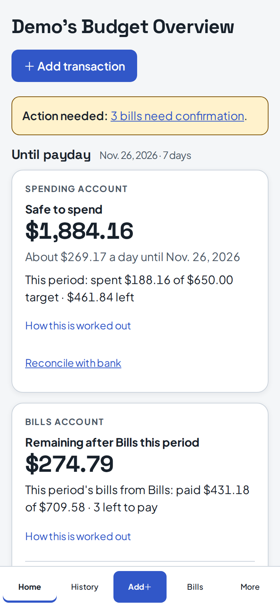

## Use the Set up your budget card

A new profile shows a **Set up your budget** card at the top of **Home**. It lists six steps,
and each one ticks itself when it is done. Select a step to go to the page for it. The steps
are the same as the chapters in this guide:

1. **Check your accounts** (Spending, Bills and Savings are ready; add others): see
   [Set up your accounts](#set-up-your-accounts).
2. **Enter each account's opening balance**: see
   [Give an account its starting balance](#give-an-account-its-starting-balance).
3. **Add the pay period you are in**: see [Set up your pay periods](#set-up-your-pay-periods).
4. **Add your recurring bills**: see [Add your recurring bills](#add-your-recurring-bills).
5. **Add the categories you use**: see [Set up your categories](#set-up-your-categories).
6. **Check a bank statement**: see
   [Import and check your first bank statement](#import-and-check-your-first-bank-statement).

The card goes away when all six steps are done. It also goes away as soon as you record your
first expense, income, refund or transfer, even if some steps are left.

## Learn a few words first

| Word | What it means |
| --- | --- |
| **Budget profile** | One household's budget. You only see the profiles you have been given. |
| **Account** | Where money sits, such as your checking account. Every profile starts with **Spending**, **Bills** and **Savings**. |
| **Spending account** | Everyday money: groceries, gas, eating out. |
| **Bills account** | Money set aside for regular bills, such as rent, electric and phone. |
| **Savings account** | Money put away, divided into savings goals. |
| **Category** | Why the money was spent, such as Groceries or Electric. Spending categories and Bill categories are kept apart. |
| **Pay period** | The days from one paycheck to the day before the next. The app plans one pay period at a time. |
| **Recurring bill** | A bill that comes back on a schedule. Each month it is due is listed separately on **Bills**. |
| **Cleared** | An entry you have checked against the bank statement. It is only a tick; it never changes a balance. |

The app works out every balance from the entries you record. Nobody types a balance in
directly. Money coming in (income, refunds) adds to an account; money going out (expenses)
takes away from it; moving money between your own accounts takes from one and adds to the
other.

## Choose or switch budget profile

You choose the profile on the sign-in page each time you sign in. If you belong to more than
one profile and opened the wrong one, select **Sign out** and sign in again with the right
profile chosen. The name of the open profile is shown at the top of the menu on a computer.

## Set up your accounts

Your profile already has three accounts: **Spending**, **Bills** and **Savings**. Give each one
its starting balance, and add any other accounts you want to follow.

### Give an account its starting balance

Do this before you record any transactions in the account.

1. Open **Accounts** (on a phone: **More → Accounts**).
2. Select **Edit** beside the account.
3. Enter today's balance from your bank in **Opening balance**, for example `1,250.00`.
   You may type it with or without the comma and dollar sign.
4. Select **Save**.

Once an account has any entries, its opening balance and type are locked. If the balance is
wrong after that, correct it by reconciling (see
[Check an account against your bank statement](#check-an-account-against-your-bank-statement)).

### Add another account

1. On **Accounts**, select **Add account**.
2. Enter a **Name**, for example `Vacation Fund`. Two accounts cannot share a name.
3. Choose the **Type**: Spending, Bills, Savings or Other.
4. Enter the **Opening balance**.
5. Enter a **Display order**. Lower numbers are listed first.
6. If you will upload bank statements, you may enter the **Statement account ending (optional)**:
   the last 4 digits of this account's number as printed on the statement. You can leave it
   blank; the first statement upload asks which account is which and fills it in.
7. Select **Save**.

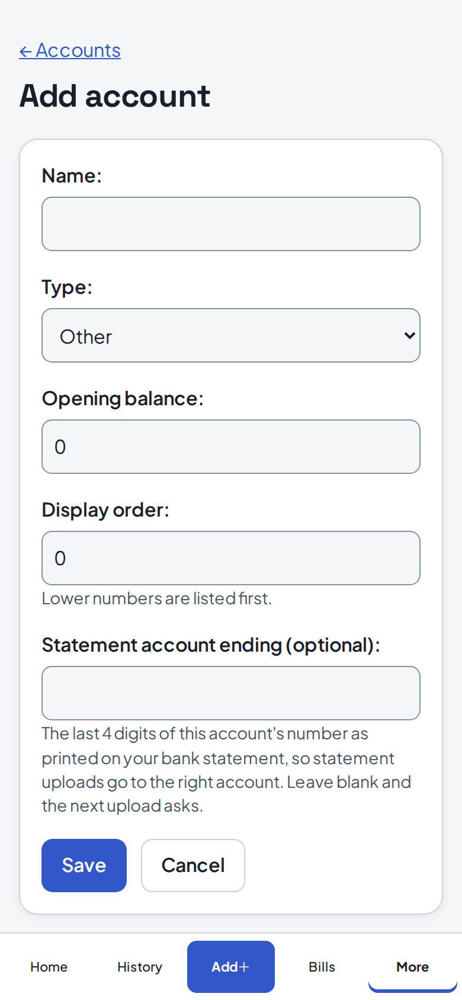

### Archive or restore an account

Select **Archive** beside an account. An account that has never been used is removed for good
instead. An account with entries is archived: it leaves the list but keeps its history, and you
can bring it back from **Archived accounts → Restore**. You cannot archive or remove your only
Spending account or your only Bills account.

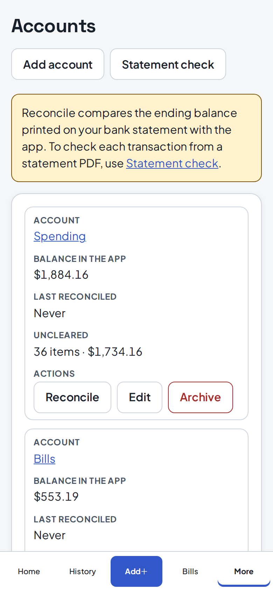

## Set up your categories

A category says *why* money was spent. Your profile starts with **General** and
**ATM Withdrawal** for spending, **Other Bills** for bills, and **Income**. Add the categories
your household actually uses.

Open **Categories** (on a phone: **More → Categories**). The page has two lists:

- **Spending (paid from Spending or Savings)**, for everyday purchases such as Groceries, Gas
  or Eating Out.
- **Bills (paid from the Bills account)**, for regular bills such as Rent, Electric or Phone.

### Add a category

1. Select **Add spending category** or **Add bill category**.
2. Enter a **Name**, for example `Groceries`.
3. Tick **Essential** for necessities such as groceries or rent. Essential categories are left
   out of the "what could you cut" ideas on Outlook. New bill categories start ticked.
4. Select **Save**.

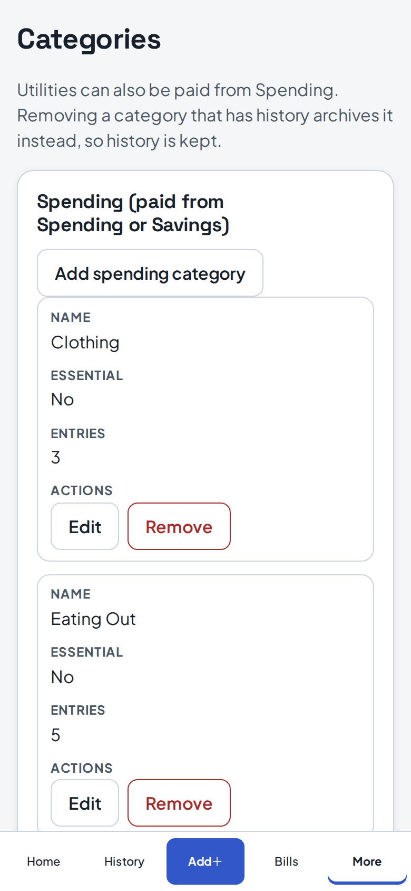

### Change or remove a category

Select **Edit** to rename a category or change **Essential**. Its kind (Spending or Bill) can
only change while nothing uses it. **Remove** deletes an unused category, or archives one that
has history; restore it from **Archived**. Income, savings and adjustment categories are listed
under **Other kinds** and cannot be changed.

> **Tip:** Use **ATM Withdrawal** when you take cash out. The withdrawal is the expense, so do
> not record the later cash purchases again.

## Set up your pay periods

The app plans around paydays. You add the pay period you are in now, then let the app create
the ones after it.

### Add the current pay period

1. Open **Budgets** (on a phone: **More → Budgets**).
2. Select **Manage pay periods**, then **＋ Add pay period**.
3. Fill in the dates:
    - **Nominal payday**: the scheduled payday, even if the money arrives early.
    - **Expected deposit date**: the day the money is expected in the bank.
    - **Start date**: the first day of this pay period (usually the day the last paycheck landed).
    - **End date**: the day before the next paycheck.
4. Leave **Is exceptional** unticked unless this period is unusual on purpose.
5. Select **Save pay period**.

Pick each date from the calendar, or type it the way your browser shows dates. Pay periods
cannot overlap, and the current one must include today's date.

### Create future pay periods

1. On **Manage pay periods**, find **Generate future pay periods**.
2. Choose how often you are paid: **Weekly**, **Bi-weekly**, **Semi-monthly** (the 1st and
   15th) or **Monthly**.
3. Choose a **Generate through** date, for example the end of the year.
4. Select **Save schedule and generate**.

Existing pay periods are never changed; only new ones are added after the last one. New periods
keep your payday schedule. Weekly, bi-weekly and monthly paydays stay on their usual dates. If
there is a gap between your last period and the next payday, the first new period is short and
covers that gap.

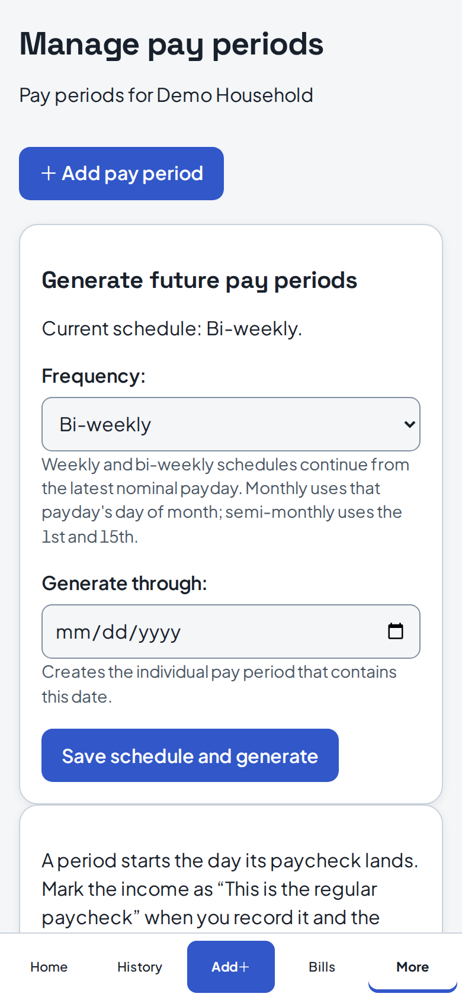

## Set your budget for the pay period

Each pay period has two numbers: how much you plan to spend, and how much you expect to be
paid.

1. Open **Budgets**. It opens the pay period that includes today.
2. Enter the **Spending target for this pay period**: what you plan to spend on everyday
   (Spending category) purchases, for example `900.00`.
3. Enter the **Expected paycheck for this pay period**, for example `2,100.00`.
4. Select **Save budget**.

New pay periods copy these two numbers from the one before, so you normally set them once and
adjust them only when something changes. To plan a different pay period, open
**Manage pay periods** and select **Budget** beside it.

### Set category budgets

You can also give individual spending categories a limit per pay period. This is optional;
categories without one are simply not compared.

1. On **Budgets**, scroll to **Category budgets (optional)**.
2. Choose the **Category**, for example `Eating Out`.
3. Enter the **Budget per pay period**, for example `150.00`.
4. Check **Effective from**. It starts at the current pay period's first day.
5. Select **Save category budget**.

Earlier pay periods keep the budget they had. Enter `0` to stop budgeting a category from that
date. You can see how each category is doing on **Habits**, in **Category budgets this pay
period**.

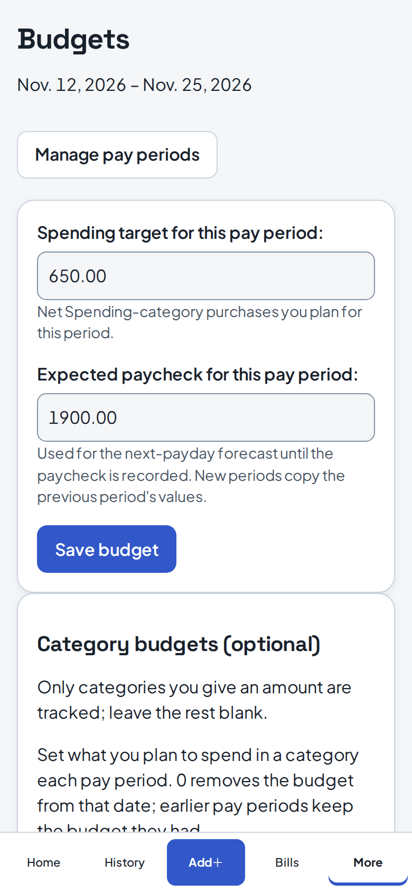

## Add your recurring bills

Add every bill that comes back on a schedule: rent, utilities, phone, insurance,
subscriptions, loan payments.

### Add a recurring bill

1. Open **Bills** and select **＋ Add bill**.
2. Fill in the form:
    - **Name**, for example `Electric`.
    - **Usual monthly amount**, for example `145.00`.
    - **Day of month due**, for example `18`.
    - **How often**: **Every month**, **Every 2 months**, **Every 3 months** or **Once a year**.
    - **Category**: a Bill category, for example `Utilities`.
    - **Payment account**: the account the bill is paid from, usually **Bills**. A bill can
     also be paid from **Spending**.
    - **First month**: the first month this bill is due.
    - **Last month (optional)**: only for a bill that will end, such as a loan with a final
     payment date.
    - **Notes**, if useful, and keep **Active** ticked.
3. Select **Save bill**.

The bill now appears on **Bills** in every month it is due.

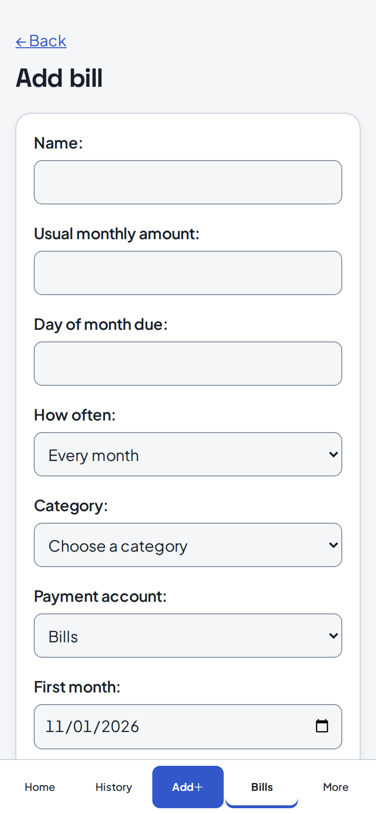

### Change how often a bill is due

1. On **Bills**, select **Edit bill** on any month of that bill.
2. Under **How often**, choose the new schedule.
3. Under **First due month**, choose the first month of the new schedule.
4. Select **Save changes**.

From today on, unpaid months that no longer fit are removed; paid, skipped and past months are
kept. The message after saving says how many months were removed and kept.

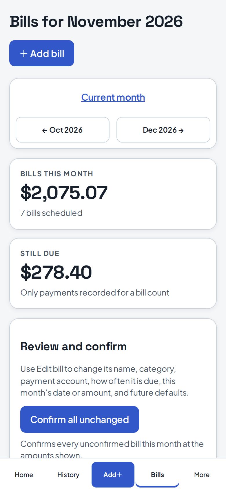

## Add your debts

Use **Debts** for loans, credit cards and a mortgage you are paying off, to see when each will
be paid off. Copy every figure from the lender's statement; the app does not guess them.

### Add a debt

1. Open **Debts** (on a phone: **More → Debts**) and select **Add a debt**.
2. Enter a **Name**, for example `Car loan`.
3. Choose the **Kind**: Loan, Credit card, Mortgage or Other.
4. Enter the **APR (%)** from the statement, for example `7.49`.
5. Enter the **Minimum payment**. It is used only when no bill is linked.
6. Under **Bills that pay this debt**, open **Choose bills** and tick the recurring bill that
   pays it, for example `Car payment`. Add the bill first on **Bills** if it is not there.
7. Select **Save**.

### Enter the balance from the lender's statement

1. On the debt's card, select **Enter balance**.
2. Set **Balance as of** to the statement date.
3. Enter the **Balance owed** from the statement.
4. Select **Save**.

Until a balance is entered, the debt shows no estimate or payoff date. Enter a new balance each
time a new statement arrives.

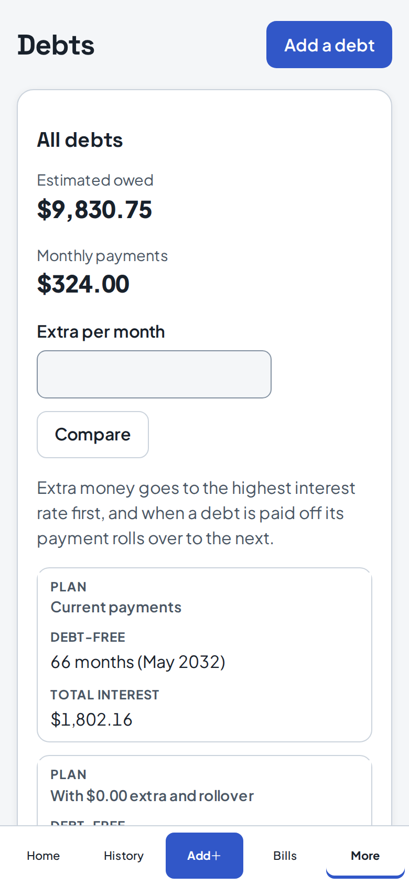

## Import and check your first bank statement

The statement check makes sure nothing was missed. The app reads your bank's monthly PDF
statement, pairs each line with an entry you recorded, and shows what is left over.

### Upload a statement

1. Download this month's statement PDF from your bank's website (one PDF covers all your
   accounts).
2. Open **Statement check** in the menu, just below **Accounts** (on a phone: **More →
   Statement check**).
3. Select **Upload a statement PDF**.
4. Choose the file under **Statement PDF**, then select **Read statement**.

Statement PDFs longer than 50 pages are refused. Upload one statement at a time.

The app checks every row against the running balance printed by the bank. If anything does
not add up, nothing is imported and the page says which account and date failed. The PDF
itself is not kept.

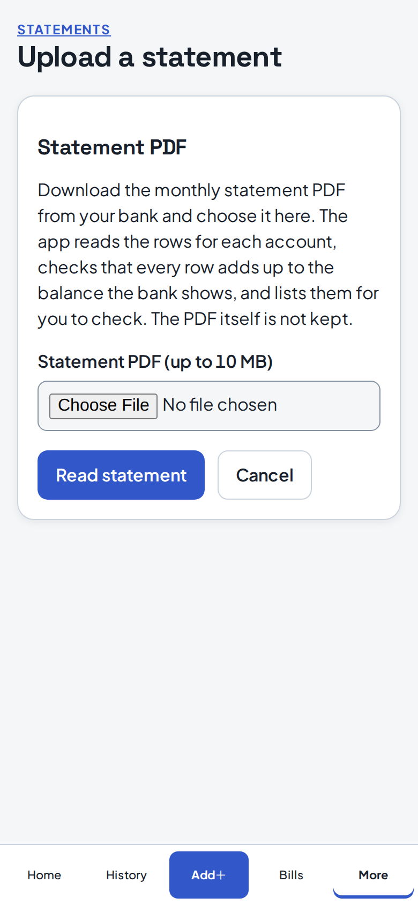

### Match each bank account to an app account

The first time, the app asks **Which account is which?**. For each bank account in the
statement (shown with its name, number of rows and ending balance), choose the matching app
account, or **Don't import this account**. Then select **Import statement**.

To stop without importing, select **Cancel**. The app discards the uploaded statement, and nothing is imported.

The app remembers the last 4 digits of each bank account number, so it only asks once. Next
time it files every account by itself. You can see or change the remembered digits at any time
on **Accounts → Edit**, under **Statement account ending (optional)**.

### Review the statement lines

The statement opens with its lines under **To review**. Each line is paired with an entry on the
same account for the same amount, dated up to 7 days before or 3 days after the bank date.

- **Same purchase** confirms the pair and marks your entry cleared.
- **Other possible entries** lists other entries that could match; pick the right one.
- **Confirm all … proposed pairs** confirms every proposed pair at once.
- **Add as new entry** opens the expense or income form already filled in, for a line you never
  recorded.
- **Dismiss** sets a line aside without matching it.
- **Undo**, under **Reviewed**, puts a line back to review.

A line marked "Possibly missed" has no entry nearby: you probably forgot to record it.
**Not on a statement yet** lists your entries the bank has not shown yet; recent ones usually
appear next month.

During first-time setup, most lines are from before your opening balance. **Dismiss** those;
do not add them as new entries, or they would be counted twice.

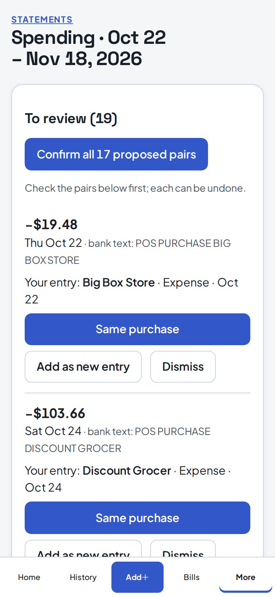

### Check an account against your bank statement

Reconciling compares the bank's ending balance with the app's balance on the same day.

1. Open **Accounts** and select **Reconcile** beside the account (or tap **Reconcile with bank**
   on a Home card).
2. Enter the **Statement date** and the **Statement balance** printed by the bank.
3. Select **Compare**. The page shows the bank balance, the app's balance and the
   **Difference (bank − app)**, with every uncleared entry up to that date.
4. Untick any entry that is not on the statement.
5. If the difference is not zero, look for a missing or mistyped entry first and fix it. If you
   cannot find it, tick **Post a balance correction** and write a short **Reason for
   correction**.
6. Select **Reconcile account**.

A balance correction changes only that account's balance. It does not count as spending or
income.

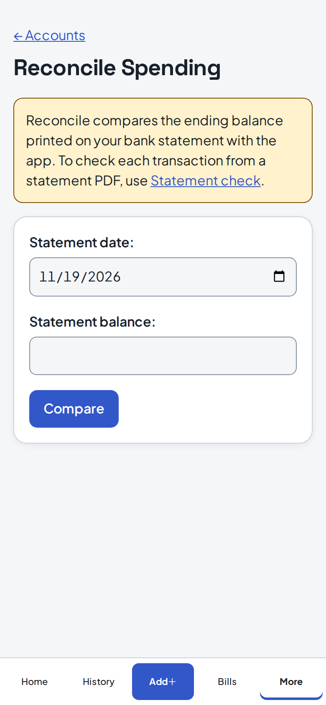

## Set up savings goals

The **Savings** page divides your Savings account into goals, such as `Emergency fund` or
`Holiday`. Money not given to a goal sits in **Unallocated Savings**.

1. Open **Savings** (on a phone: **More → Savings**) and select **Add goal**.
2. Enter a **Name** and a **Target amount**, for example `1,000.00`.
3. Enter a **Priority**. Number 1 is funded first.
4. To start the goal with money already in Savings, enter an **Initial allocated amount** and
   choose **Move the initial amount from** (usually **Unallocated Savings**).
5. Select **Save savings goal**.

The goals together always add up to the Savings balance. If they do not, the page shows the
difference and a button to assign it to Unallocated Savings. Nothing changes until you press it.

To delete a goal, select **Delete** on its card. Only a goal with no entries has that button.
The app asks you to confirm first. The confirmation page says the deletion cannot be undone;
select **Delete goal** to go ahead.

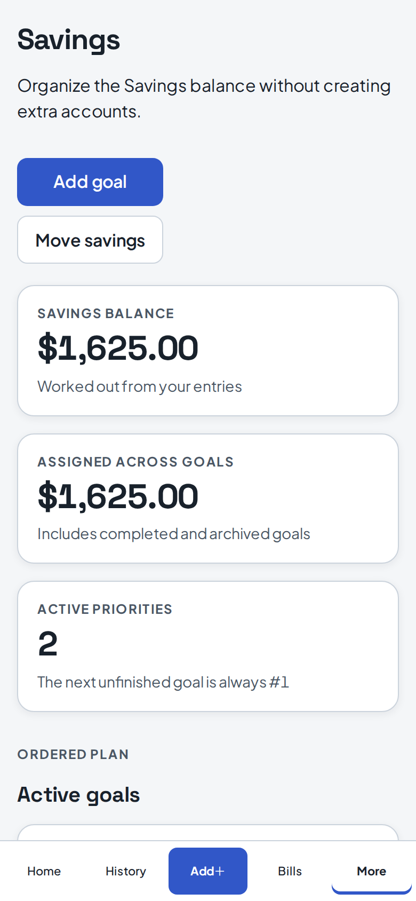

## Choose light or dark display

Select **Display Mode** at the bottom of the menu on a computer, or **More → Display mode** on
a phone, then choose ☀ (light), ☾ (dark) or 🖥 (follow the device's setting). The choice is
saved to your sign-in, so it follows you to every phone, computer and browser you sign in on.

## Checklist: your profile is ready when…

- You can sign in at the app's address with no certificate warning.
- **Spending**, **Bills** and **Savings** show the same balances as your bank.
- Your spending and bill categories are added.
- The current pay period includes today, and future ones are generated.
- **Budgets** shows your spending target and expected paycheck.
- Every recurring bill is on **Bills**, with the right amount, due day and account.
- Each debt has its APR, linked bill and latest statement balance.
- Your first statement is imported, reviewed, and each account reconciled with a
      difference of $0.00.
- Savings goals add up to the Savings balance.
- Home shows **Safe to spend** with no warnings you don't understand (see
      [Understanding the numbers](understanding-the-numbers.md)).

When every box is ticked, move on to [Everyday use](everyday-use.md).
