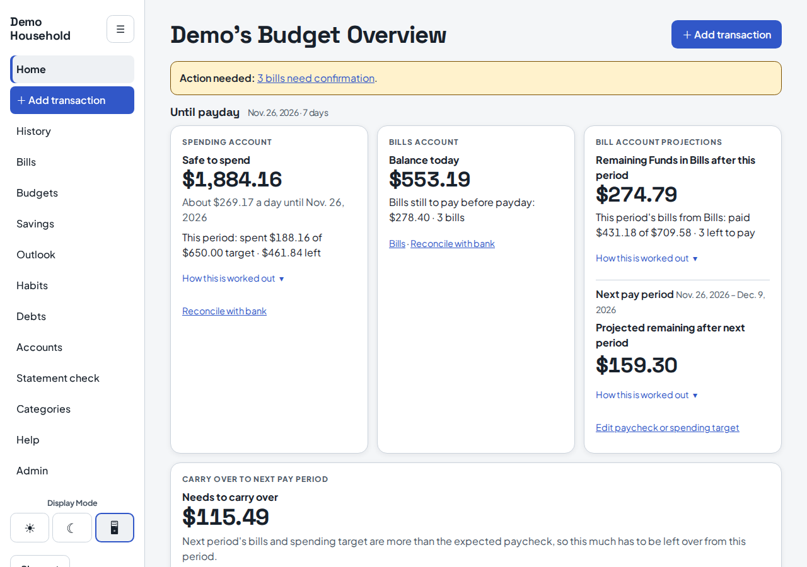

# Understanding the numbers

This chapter explains every figure on Home and on Outlook: what it means, where it comes
from, and what to do when it looks surprising. On Home, every card has a
**How this is worked out** link. Tap it to see the same sums with your own numbers.

## The ground rules

The app follows a few fixed rules. Most surprises make sense once you know them.

- **Balances come from your entries.** Nobody types in a balance. Each account starts at its
  opening balance; income and refunds add to it, expenses take away, and money moved between
  accounts takes from one and adds to the other. To bring an account in line with the bank,
  you reconcile it (see
  [Check an account against your bank statement](getting-started.md#check-an-account-against-your-bank-statement)).
- **Spending and Bills are kept apart.** Everyday spending is planned against your spending
  target. Bills are planned against your list of recurring bills. One never hides the other.
- **Refunds are not income.** A refund lowers the spending in its category.
- **Moving money is neither income nor spending.** A transfer from Spending to Bills changes the
  two balances and nothing else.
- **The current pay period** runs from the day your paycheck landed to the day before the next
  payday. All Home figures are about the days *until the next payday*.

## The Until payday cards on Home

The top of Home is headed **Until payday**, with the next payday's date and the number of days
left. Below it are three cards.

### Safe to spend

The large figure on the **Spending account** card is what you can spend on everyday things
until payday without falling short anywhere else. Below it, the card shows about how much that
is per day.

Open **How this is worked out** to see:

| Line | Meaning |
| --- | --- |
| **Spending balance** | What is in the Spending account today. |
| **− bills paid from Spending before payday** | Bills set to be paid from Spending that are still due before payday. |
| **− held for next period** | Money kept back because next pay period will need more than the paycheck brings in and the Bills account can't cover it (see [Carry over to next pay period](#carry-over-to-next-pay-period)). |
| **= Safe to spend** | What is left to spend. |

If Safe to spend is negative, the card says **Short by $… before payday**. That means you
would need to move money into Spending, or spend less, to get through to payday.

The line **This period: spent … of … target** compares what you have spent this pay period
(after refunds) with your spending target.

### Bills account

The **Bills account** card, next to Spending, shows **Balance today** (what is in the Bills
account now) and **Bills still to pay before payday**: the unpaid bills due from the Bills
account before payday, with how many there are. Bills paid from Spending are not counted here.

### Remaining Funds in Bills after this period

The first figure on the **Bill Account Projections** card is what the Bills account will have
left once every bill still due before payday has been paid.

| Line | Meaning |
| --- | --- |
| **Bills balance** | What is in the Bills account today. |
| **− unpaid bills before payday** | Bills paid from the Bills account that are still due before payday. |
| **= Remaining Funds in Bills after this period** | What is left in Bills on payday. |

The line **This period's bills from Bills: paid … of …** shows how far through this period's
bills you are.

### Projected remaining after next period

Lower on the same card, under **Next pay period** and its dates, is a look one period ahead:
what will be left at the end of next pay period if everything goes to plan.

| Line | Meaning |
| --- | --- |
| **Remaining Funds in Bills after this period** | The figure above. |
| **+ expected paycheck** | The next paycheck: the amount on **Budgets** for that period, or the real paycheck once it is recorded. |
| **− next period's bills** | Every bill due in the next pay period, from any account. |
| **− spending target** | Next period's spending target. If none is set, the line reads **− expected spending (recent average; no target set)** and uses your average spending over the last three finished pay periods. |
| **= Projected remaining after next period** | What should be left after next period's bills and spending. |

Under the sums, the card says where the paycheck and spending figures came from. The
**Edit paycheck or spending target** link opens **Budgets** for that next period.

### Carry over to next pay period

The third card answers the question "how much of this period's money has to be left over to
get through the next one?"

| Line | Meaning |
| --- | --- |
| **Next period's bills** | Every bill due next pay period. |
| **+ spending target** (or **+ expected spending**) | What you plan to spend next period. |
| **− expected paycheck** | What next payday brings in. The whole amount counts, even if part of it is meant for Savings. |
| **= Needs to carry over** | The gap. It is never shown below $0.00. |

When a carry-over is needed, the card shows where it comes from:

- **From Bills (remaining funds in Bills after this period)**: the Bills account covers as much as it
  has left after this period's bills.
- **From Spending (held for next period)**: Spending holds back the rest. This is the
  **held for next period** line on the Safe to spend card, which is why Safe to spend goes down.

If the Bills account is short this period too, the card adds that Spending is also holding back
that shortfall. When nothing needs to carry over, the card says so and shows how much the next
paycheck has to spare.

### Example

Say Spending holds `$1,200.00`, Bills holds `$900.00`, and before payday you still owe `$600.00`
in bills from Bills and `$50.00` from Spending. Next period has `$1,500.00` of bills, a
`$1,000.00` spending target, and a `$2,100.00` paycheck.

- **Remaining Funds in Bills after this period** = 900 − 600 = **$300.00**.
- **Needs to carry over** = 1,500 + 1,000 − 2,100 = **$400.00**: $300.00 from Bills and
  $100.00 from Spending.
- **Safe to spend** = 1,200 − 50 − 100 = **$1,050.00**.
- **Projected remaining after next period** = 300 + 2,100 − 1,500 − 1,000 = **−⁠$100.00**, and the
  card says the next period is short by $100.00, all of it held back on the Spending card.

### Why a negative number can appear when money is carrying over

A negative **Projected remaining after next period** looks alarming, but read the line under it.
It usually says "Next period is short by $X. $X of it is held back on the Spending card." That
means the shortfall is already taken care of: Safe to spend has been lowered by the same amount,
so if you keep within Safe to spend, that money will still be there on payday to carry over.

The figure on the Bill Account Projections card assumes the Bills account works alone. The **Carry over** card
shows the full picture, with Bills and Spending working together. Only worry if the Spending
card itself shows **Short by**.

### Older unpaid bills

A warning such as "2 older unpaid bills ($180.00) need review" means bills from before this pay
period are still open. They are left out of all the figures above until you mark them paid or
skip them on **Bills**.

## The spending pie on Home

Below the cards, **Current pay period** shows the period's dates, the time remaining, and
whether it is **Open** or **🔒 Locked**. Its **Spending habits** pie shows what you have spent
from the Spending account this pay period, by category, after refunds.

- Tap a slice, or hover over it with a mouse, to see its category, amount and share.
- On a keyboard, press Tab to move from slice to slice.
- The list beside the pie shows every category with its amount and percentage.

## Read the Outlook page

**Outlook** looks at any date range you choose, normally the current pay period. Pick
**From** and **To**, then select **Update outlook**. The heading says how far the actual figures
go ("Actual activity through …"); after that date, the figures are projections.

### Bottom line up front

**Forecast for this range** sums up the range in a few sentences and names the largest
non-bill spending area and its main merchants.

### Totals and the projected end balance

The cards show **Projected income** (received so far plus paychecks still expected),
**Actual income**, **Projected expenses** and the **Projected end balance**.

The projected end balance comes with a note such as:

> Based on your spending over the last 3 pay periods, you are averaging $45.20 a day. At that
> pace, Spending and Bills together would be $210.00 short by Dec 14, an additional $210.00 the
> next pay period would need to cover. This is a projection from past spending; your actual
> spending can make it smaller or larger.

This is a trend, not a bill. If you spend less than your recent average, the shortfall shrinks
or disappears. If there are no finished pay periods yet, the note uses the spending target
instead.

If the range starts more than one day after today, the projected end balance also takes away
the spending expected between today and the start of the range, and the unpaid bills due in that
gap. Open **Formula and inputs** under **Projected end balance** to see the lines
**Spending before the range** and **Bills before the range**.

### Spending forecast

**Spending pace** lists **Actual non-bill spending**, the **Selected-range budget target**,
**Projected remaining spending**, **Actual Bills spending** and **Bills spending last cycle**.

### Spending by category pie

The pie is headed **Spending after refunds**. As on Home, tap or hover over a slice to see its
category and amount. The table beside it lists every category.

### Daily net spending chart

The **Daily net spending** chart has one point per day.

- **Tap or hover** over a point to see that day's date and spending.
- **Zoom** with the **+** and **−** buttons, the mouse scroll wheel, or two fingers (pinch) on a
  phone. **Whole range** zooms back out.
- When zoomed in, drag sideways to move along the dates.

### What could move to Savings

This section shows your non-essential spending at its monthly pace and how much you could save
by cutting it a little, more, or a lot. Categories marked **Essential** are left out. Open
**Adjust forecast assumptions** to choose which categories count as non-essential and the three
cut percentages, then **Save assumptions**.

### AI analysis

**Generate AI analysis** asks the local AI model your administrator has set up to write a
plain-language review that compares this range with the one before. It sees only totals and
category names, never merchants or notes. If it quotes a figure that is not in the report, the
app shows a plain summary instead. The charts and tables are always the true figures.

## How a statement knows which account is which

Your bank's monthly PDF has a separate section for each account, headed by the account's name
and number. The first time you import a statement, you tell the app which app account each bank
account is. The app remembers the **last 4 digits** of each bank account number, so the next
statement's lines go to the right accounts by themselves.

It never guesses from merchant names. Each statement line is then paired only with entries on
that same account, for the same amount, dated up to 7 days before or 3 days after the bank's
date. Merchant names on the statement are shown for reference and never change your entries.

## Cleared, reconciled and balance corrections

- **Cleared** is a tick that says "I've seen this on the bank statement". It changes nothing
  else.
- **Reconciling** compares the bank's ending balance with the app's balance on that day, and
  shows the difference.
- A **balance correction** is posted only when you choose to, to make up a difference you
  could not trace. It changes that one account's balance and nothing else: not spending,
  income, bills or budgets. It shows in History as **Balance correction** with your reason.

## Debts: estimate and payoff

On each debt's card:

- **Monthly payment** is the total of the linked bills, or the minimum payment if no bill is
  linked.
- **Latest entered balance** is the last figure you copied from a statement.
- **Estimated balance now** adds simple interest at the APR since that statement date and takes
  off the payments made through the linked bills since then. **How this is worked out** shows
  each step.
- The payoff line says "Paid off in N months" with the month and total interest, or warns that
  the debt never pays off because the payment is not more than a month's interest.

Under **All debts**, **Extra per month** compares your current plan with paying extra. The extra
goes to the highest-rate debt first, and when a debt is paid off its payment rolls over to the
next one.
